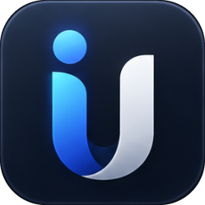
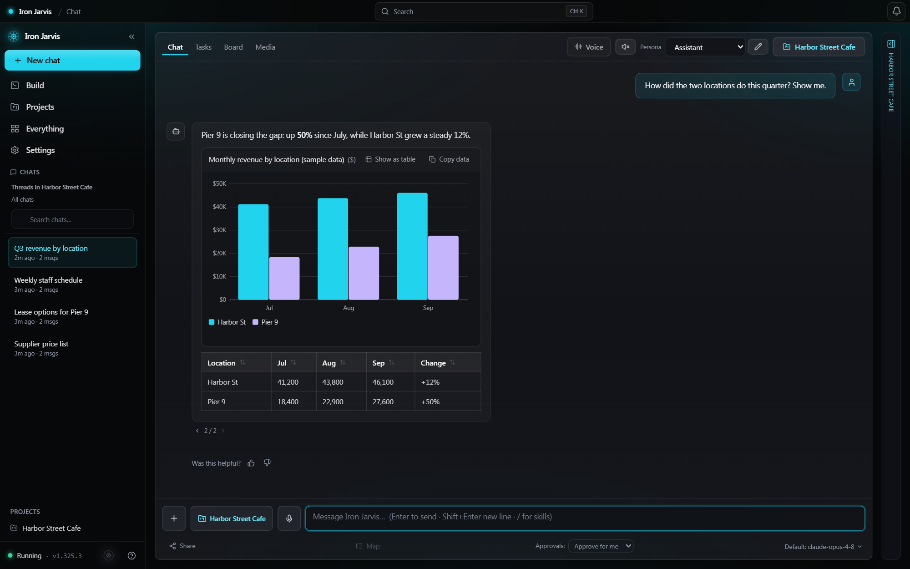
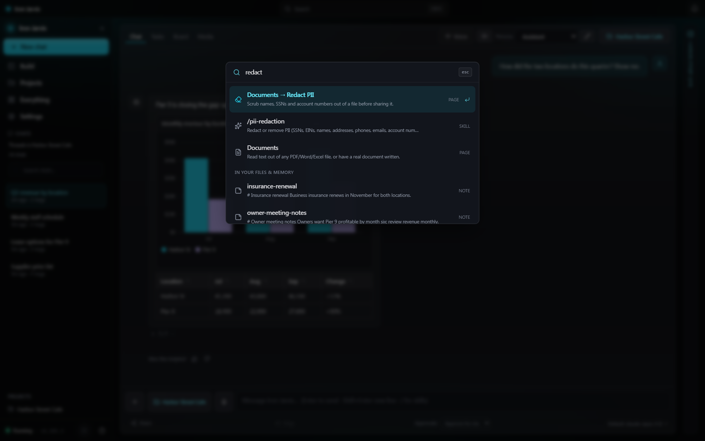
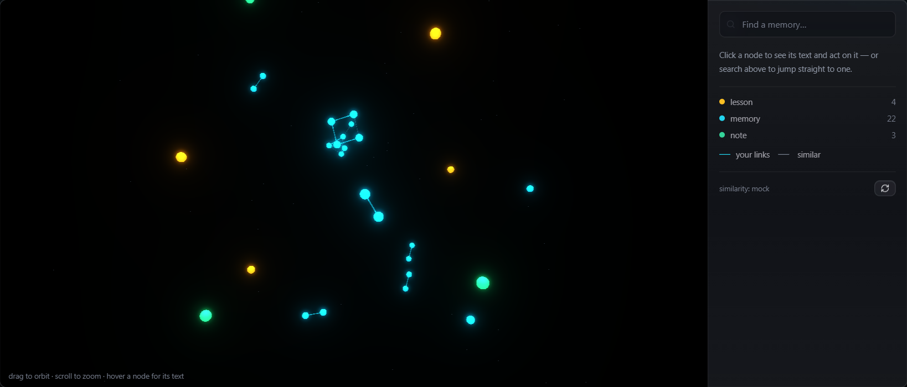

<div align="center">

#  IRON JARVIS

[](https://github.com/RealDealCPA-VR/Iron-Jarvis/actions/workflows/release.yml)
[](https://github.com/RealDealCPA-VR/Iron-Jarvis/releases/latest)

[](LICENSE)

### The AI operating system you actually own.

**Your models. Your tools. Your files. One place, on your own PC.**

Every action logged. Every change reviewable. Every secret encrypted on your disk.

</div>

---

Claude Code can code. Codex can code. Local models run privately on your own GPUs. MCP servers bring tools. Each one lives in its own window, with its own memory, its own permissions, its own login and its own idea of what you're working on.

**Iron Jarvis is the layer that makes them one system.** It gives all of them shared projects, memory, permissions, accounts, browser access, automation and a full record of what happened, behind one interface, on **your** computer. You don't replace anything. Iron Jarvis is where it all starts working together.

Bring an API key, the Claude or ChatGPT subscription you already pay for, or your own GPUs. Or try it fully offline with a built-in demo model.

<div align="center">



*A reply with a chart and a sortable table. "‹ 2 / 2 ›" means the earlier answer was kept, not thrown away. (Sample data.)*

</div>

## 🔥 Why Iron Jarvis

- **Just ask.** "Make a project for the Johnson audit." "Turn off the GitHub app." "Stop sending alerts to Slack." "Keep this chat on my PC." Chat does the setup itself: it shows you a card first, and every change has an **Undo**. When a step truly needs a page, like signing in or a vendor's approval, chat gives you one button to the exact place.
- **The coding tools are interchangeable workers. Iron Jarvis is the stable layer.** Claude Code, Codex, Pi, OpenCode and Grok run as the real tools underneath, with their own features on. Switch between them or run several at once without losing your projects, history or settings. When a better tool ships next month, it moves into the same home.
- **It does the work and shows its receipts.** Every reply says which model answered, which tools ran and which files changed. A tool the turn wasn't given is refused and recorded, never quietly run. If a reply claims it changed a setting and nothing actually changed, a note under the reply says so.
- **It never moves your data, or your money, behind your back.** If your local model is down, it says so **by name** instead of quietly sending your conversation to a cloud API. It never switches you to a pay-per-use model you didn't pick. Only **Auto**, if you choose it, may switch providers.
- **Built for sensitive work.** Turn on **Local only** and that chat's AI runs on this PC or your own network, and anything that would reach the internet asks you first. Microsoft 365 connects locked down: read and draft only, one account, and only in Local only chats. Keys and passwords go into a secure box, never into the chat.
- **You approve what matters.** Risky actions ask first. Code changes land on a git branch and **never auto-merge**. File writes, documents, notes and settings have an **Undo**.
- **Failures are contained, visible and recoverable.** A step that hangs is stopped and named. A tool that breaks says why, where you're looking. Work a restart cut off waits for you with **Continue**.

---

## ✨ Highlights

### 🛠️ One home for your coding agents
- **Every coding agent, one workspace.** **Build › Code** runs **Claude Code, Codex, Pi, OpenCode and Grok** as themselves, with their own skills, commands and saved conversations, so `claude --resume` still works from a terminal. **Chat › Code** is Iron Jarvis's own coding harness, on any model you connect, local ones included.
- **Start by typing.** Pick a folder, tool, account, model, effort and permission level only when you need to. Attach screenshots, and steer the work while it runs without stopping it.
- **See everything.** What changed, usage and cost per reply, exactly what fills the context window, and which background helpers are still working. When they finish, their report appears on its own.
- **Never lose the thread.** Sessions reopen where they left off and a reply survives a restart. In a git folder, Iron Jarvis's own sessions work on their own branch, with Commit and **Open a pull request** one press away.
- **Skills follow you.** A skill you installed for Claude Code, Codex, Grok, Pi or OpenCode works in Iron Jarvis's coding sessions the way it works there.
- **Many accounts, one switch.** The bundled [Iron-Proxy](https://github.com/RealDealCPA-VR/Iron-Proxy) holds several Claude, Codex or Grok logins. Pick the account per session; when one hits its limit, the work waits it out or moves to another account in a group you made, never to a different provider.
- **Real terminals too.** Tiled live terminals for your shells and CLIs keep running when you leave the page.

Iron Jarvis doesn't replace the coding tools you already like. It gives them one consistent home.

### 👥 A model team, and a night shift
- **Model Team.** Give a coding session a team: a **lead** that plans and checks but never edits, **workers** that write the code, and a **reviewer** that reads every change before it lands. The roles are enforced, not suggested, and if the lead ever had to do a piece itself, the receipt says so. Members can be local models, your plans or API keys, and local models are asked first.
- **Night Shift.** Give it work tonight. Review what happened tomorrow morning. Queued coding tasks run overnight, each on its own branch. File edits and commands run unasked; anything else waits for you and is declined if nobody answers. Finished work is committed to that branch with secrets and huge files screened out, and is never pushed or merged. Your main folder is watched, **Emergency stop** halts everything, and the morning brings one summary with **Push**, **Open a pull request** or **Throw away** beside each task.

### 💬 Chat that keeps up with you
- **One box for everything.** Type **/** for a skill, drop files anywhere, pick a project so every reply grounds in its brief, folder and knowledge. There's no mode picker: a quick question gets a quick answer, and a job that needs files and tools becomes a full agent run on its own, with the reason shown.
- **Set it all up by asking.** Settings, projects, agents, apps, notification destinations, goals and Local only can all be changed from chat, each with a card first and an **Undo**. Ask "What did you change today?" for the list, or "Undo that". Protected settings always ask first.
- **Nothing gets lost.** Editing a question or pressing Try again keeps the old answer (**‹ 1 / 2 ›**). Steer a reply mid-answer, queue the next one (**Ctrl+Enter**), and **Continue** a reply that was cut off. Charts and tables come back sortable and copyable.
- **Voice, offline.** Speech-to-text is bundled (Vosk), so dictation works with no key and no cloud.

### 🤖 Agents that do real work
- **Missions.** Give the team one objective. Jarvis splits it among specialist agents, shows each one's progress, and puts the finished deliverable first.
- **Agents you can hire.** A custom agent gets a job card, a monthly budget that pauses it when spent, its own notes, and a coach that suggests better instructions for you to accept or decline.
- **Automations without cron.** Schedules, a visual workflow canvas, webhooks, and triggers from email, calendar or Slack. Agents can create these too, and you can see and edit what they made.

### 🧠 It knows you and your stuff
- **One you, every model.** A **You** page sets who you are, how answers should read and the language they come back in. Say "from now on…" and it remembers; correct it the same way twice and it asks once whether to keep the rule.
- **Memory you can touch.** Four memory layers, plus bases you plug in with **Add a memory base**: a folder or Obsidian vault, Notion, cloud drives, a machine over SSH, or an MCP memory server. All of it renders as a 3D graph.
- **Every file type.** Read and write PDF, Word, Excel, PowerPoint, CSV and Markdown. **PII redaction** really deletes the text from a PDF and re-reads the result to prove it's gone. A creative studio makes images, video, music and speech.

### 🔌 It plugs into your world
- 🌐 **Your own browser, as a capability.** The installer ships a small browser **add-on** for Chrome or Edge. Pair it and ask about the page in front of you, or let it click, type and navigate. Anything that looks destructive or transactional stops and asks first. Page text is treated as data, so a page can't give Jarvis orders, and form values are never collected. Whatever harness you pick in **Build** drives the *same* browser through the same gates.
- 📱 **Chat from your phone.** Text Jarvis over Telegram, Slack or email like a person: the same memory and tools behind a sender allowlist, and the conversation shows up on the desktop.
- 🧩 **Your apps, one sentence away.** Paste an MCP server's config from any tool, or say "add the QuickBooks server I use in Claude Desktop" to bring it over from Claude Desktop, Claude Code, Codex, Cursor or VS Code. Its keys go straight into the encrypted vault. A tool a server adds later that can write is held until you approve it.
- 🖥️ **Your own GPUs, watched live.** Tokens/sec, queue, VRAM and context windows for every local server. A number it can't read says so rather than showing zero.

### 🛡️ Trust you can check
- 🧾 **The roster is the contract, no cloud by fallback, honest outcomes.** An agent or chat can only call the tools it was given; anything else is refused and logged as *not armed*. A local model that is down or errors refuses **by name** instead of failing over to a cloud API (`local_primary_policy = refuse` by default; Auto is the one route that may substitute). And every finished run carries an outcome beside its status (*completed*, *with failures* or *needs you*) taken from the ledger, never from the model's closing paragraph.
- **The bell** lists every run that is waiting for you, and an ask nobody answered ends up on the session's outcome (*needs you*), not in a forgotten corner.
- **Context is screened.** Project notes, attachments, outside skills, memory and tool results are scanned for hidden instructions before a model sees them. Work that arrives from your phone, or touches flagged content, runs with fewer powers.
- **Activity** replays every action, token and decision, and is where you Undo. **Safety checks** run rules over what Jarvis did, and over your Claude Code and Codex history, which it reads but never changes.

<div align="center">



*Ctrl K reaches every page, skill, chat and buried setting, and always ends with "Ask Iron Jarvis".*

</div>

---

## ⚡ Built to stay out of your way

A daily driver has to be light. Measured on our own daily-driver PC:

- **Add-ons start directly.** With four MCP add-ons running, Iron Jarvis went from **19 processes to 8** and from **774 MB to 415 MB** of memory, because each server now starts without its npx/uvx launcher idling beside it. An npx add-on now starts in **0.5–0.7 s instead of 2.3–3.1 s**.
- **Idle terminals cost nothing.** Eight idle Build terminals used to keep a whole CPU core busy; they now use **0.08%**.
- **Proof, not promises.** More than 24,000 backend tests and 9,000 dashboard tests run **offline** with no keys. CI runs them once for every release and blocks the installer until they pass. The live result is on the [Tests badge](https://github.com/RealDealCPA-VR/Iron-Jarvis/actions/workflows/release.yml).

---

## 📦 Install

### 🪟 Windows desktop app (recommended, no dependencies)

1. **Download** `Iron-Jarvis-Setup-<version>.exe` from the **[latest release](https://github.com/RealDealCPA-VR/Iron-Jarvis/releases/latest)**. Ignore the `.blockmap` and `latest.yml` files; the updater uses those.
2. **Install.** The app isn't code-signed yet ([why](docs/SIGNING.md)), so SmartScreen shows *"Windows protected your PC"*. Click **More info → Run anyway**.
3. **Connect a model.** If you're signed in to Claude Code or Codex, or Ollama is running with a model downloaded, the empty chat offers it as one press. It never picks one for you. You can also **Sign in** to Claude Code or Codex from inside the app, paste an API key (Anthropic, OpenAI, xAI, OpenRouter, Google AI Studio), or point it at a local Ollama / vLLM / LM Studio / OpenAI-compatible server under **Settings → Connections**. Until you choose, a **Demo replies** strip says replies come from the built-in demo model.

Iron Jarvis inherits your subscription through the logged-in CLI. It never performs an account login itself and never sees that credential.

**Day to day**
- **Closing the window doesn't quit.** It goes to the tray so schedules and the night shift keep running. Reopen it from the tray or with **Ctrl+Shift+J**; **Ctrl+Shift+Space** opens a quick ask from anywhere.
- **Updates install themselves.** New versions download in the background and install when you click **Restart to update**. Want fewer of them? Pick the **Stable** update channel under **Settings → System**.
- **Your data lives in `%APPDATA%\Iron Jarvis`** and survives updates and reinstalls.

**If something looks wrong:** *"Iron Jarvis isn't responding"* only appears after two missed polls, and your chats and files are saved while it shows. Anything a restart stopped waits in the bell with **Continue**. If it stays, quit from the tray and relaunch (or tray → **Restart Iron Jarvis**), then **Settings → Maintenance → Copy diagnostics / Open logs folder** shows why. `ironjarvis doctor`, `repair`, `rollback`, `reset-config` and `backup`/`restore` are one-command recoveries that work even when the background service won't start.

### 💻 From source (macOS / Linux / Windows)

Needs **Python 3.12+**, [uv](https://docs.astral.sh/uv/), **Node 20+** and [pnpm](https://pnpm.io/).

```bash
git clone https://github.com/RealDealCPA-VR/Iron-Jarvis && cd Iron-Jarvis
uv sync --extra dev
cd dashboard && pnpm install && pnpm build && cd ..
uv run ironjarvis up          # Iron Jarvis + dashboard, opens your browser
```

No keys? `uv run ironjarvis demo` runs end to end with the built-in demo model. To run it on a server, see [`DEPLOY.md`](DEPLOY.md) (Docker Compose, Render, Railway, DigitalOcean, AWS, Azure). The API runs code by design, so read the security checklist there first.

---

## 🏗️ Under the hood

```
Desktop (Electron) ── tray · updates · hotkeys · pop-out windows
   ├─ Dashboard (Next.js 15) ── chat, Build, projects, missions, memory graph, settings
   └─ Daemon (FastAPI, 127.0.0.1:8787, token-protected)
        ├─ Router ── providers · strict local refusal · breaker · Iron-Proxy accounts
        ├─ Coding ── Claude Code · Codex · Pi · OpenCode · Grok · model team · night shift
        ├─ Agents ── runtime · missions · assignments · coach · trust posture
        ├─ Tools ── fail-closed permissions · undo journal · sandbox · MCP
        ├─ Memory ── 4 layers · memory bases · lessons · graph
        └─ Automations ── schedules · workflows · webhooks · triggers
   SQLite (WAL, self-healing migrations) · Fernet-encrypted vault
```

<div align="center">



*The memory graph: lessons, memories and notes as nodes. Solid lines are links you drew; dashed ones are computed similarity. Click a node to read it, connect it or prune it.*

</div>

## 📚 Learn more

- **[The Handbook](docs/HANDBOOK.md)** covers every surface, the trust model and troubleshooting.
- **[Recommended settings](docs/RECOMMENDED-SETTINGS.md)** is a tuned daily-driver setup.
- **[Local models by RAM tier](docs/LOCAL-MODELS.md)** says what to run at 8–128 GB and how to connect it.
- **[What's next](docs/TODO.md)** lists everything still open.

## License

**Free to use**, personally or inside your business, under [Apache 2.0 with the Commons Clause](LICENSE). You may use, modify and share it. You may **not sell it**, offer it as a paid or hosted service, or sell products whose value comes substantially from it. That makes it *source-available*, not OSI open source. Want to do something commercial? Open an issue and ask.

<div align="center">

**Iron Jarvis**: *the AI operating system you actually own.*

Built with [Claude Code](https://claude.com/claude-code).

</div>
