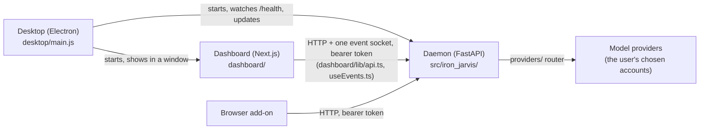
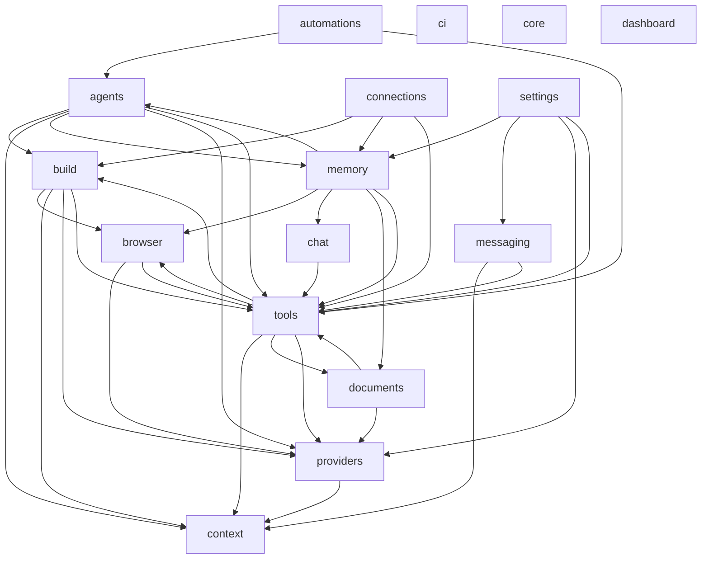

# Dependency graph

<!-- Generated by scripts/gen_dep_graph.py; do not edit. Run it again after a change. -->

What depends on what in Iron Jarvis, read from the code. Use it before an
upgrade to see what moves with the thing you change. **An arrow `A --> B` means
A imports B, so a change to B can break A.**

For one file, package, library or route, ask the script instead of reading
this page. It answers at file level and names the test files to run locally:

```bash
uv run python scripts/gen_dep_graph.py --impact workmap
uv run python scripts/gen_dep_graph.py --impact src/iron_jarvis/workmap/clients/store.py
uv run python scripts/gen_dep_graph.py --impact pypdf
uv run python scripts/gen_dep_graph.py --impact /clients
uv run python scripts/gen_dep_graph.py --impact next
```

## The three processes



The contract between the dashboard and the daemon is the route table further
down: renaming or reshaping a route breaks every dashboard folder listed on
its row. The packaged build pins all three together (one version, one
installer), so a route change and its dashboard change ship in one release.

## Areas

Each box is an area from the `CLAUDE.md` table (its rules are in
`docs/rules/<area>.md`). The picture uses **load-time** imports only (the
`import` lines at the top of a file), which show how the code is layered.
Arrows into `core` are left out because every area has one. `core` here
is `core/` plus `maintenance.py` and the package root. The two
composition roots, `platform.py` (builds every subsystem once) and
`daemon/` (the app factory and the routes), import every area and are
left out. Imports inside functions add many more edges: see the
package table for the full blast radius.



| Area | Imports at load time | Imported at load time by |
|---|---|---|
| core | none | agents, automations, browser, build, chat, connections, context, dashboard, documents, memory, messaging, providers, settings, tools |
| tools | browser, build, context, core, documents, providers | agents, automations, browser, build, chat, connections, documents, memory, messaging, settings |
| providers | context, core | agents, browser, build, documents, settings, tools |
| context | core | agents, build, messaging, providers, tools |
| browser | core, providers, tools | build, memory, tools |
| build | browser, context, core, providers, tools | agents, connections, tools |
| memory | agents, browser, chat, core, documents, tools | agents, connections, settings |
| agents | build, context, core, memory, providers, tools | automations, memory |
| documents | core, providers, tools | memory, tools |
| chat | core, tools | memory |
| messaging | context, core, tools | settings |
| automations | agents, core, tools | none |
| ci | none | none |
| connections | build, core, memory, tools | none |
| dashboard | core | none |
| settings | core, memory, messaging, providers, tools | none |

## Packages

One row per package under `src/iron_jarvis/`, most-depended-on first.
"Imported by" counts every import, including those inside functions:
it is the blast radius, every package a change here can break. "Imports"
splits what the package needs to load from what it reaches only when a
function runs.

| Package | Area | Files | Imported by | Imports at load time | Imports inside functions only |
|---|---|---:|---|---|---|
| `core` | daemon | 35 | **71**: agents, artifacts, assignments, audio_worker, backgrounds, blackboard, brain, browser, capability, capability_search, checks, coach, codehost, codelab, comm, computeruse, connections, connectors, context, creative, daemon, deliverables, detections, documents, envelope, eval, filesearch, fleet, git, goals, guide, harness, harness_bench, hosted, improve, improvement, inbox, integrations, iron_proxy, learning, ltm, maintenance, mcp, mcpserver, media, memory, motivation, onboarding, peers, personas, platform, profile, projects, providers, reflex, repl, sandbox, scheduling, search, secrets, sentinels, settings, skills, templates, terminals, tools, triggers, webhooks, workflows, worklist, workmap | none | agents, computeruse, detections, harness, iron_proxy, profile, providers, search, secrets, settings, tools |
| `tools` | tools | 30 | **48**: agents, assignments, blackboard, brain, browser, capability, capability_search, checks, coach, codelab, comm, computeruse, connectors, core, daemon, documents, eval, filesearch, goals, guide, harness, harness_bench, hosted, improve, inbox, integrations, learning, ltm, mcp, mcpserver, memory, motivation, platform, projects, providers, reflex, sandbox, scheduling, search, secrets, sentinels, settings, skills, triggers, webhooks, workflows, worklist, workmap | browser, computeruse, context, core, detections, harness, media, providers, sandbox | __init__, agents, capability_search, connectors, creative, daemon, deliverables, documents, eval, mcp, onboarding, reflex, repl, scheduling, settings, skills, terminals |
| `providers` | providers | 48 | **43**: agents, brain, browser, capability_search, checks, coach, comm, computeruse, connections, connectors, core, daemon, documents, eval, fleet, goals, harness, harness_bench, history, hosted, improve, improvement, inbox, iron_proxy, learning, ltm, mcp, media, memory, motivation, onboarding, platform, projects, reflex, scheduling, search, settings, skills, terminals, tools, triggers, workflows, workmap | context, core, envelope | __init__, agents, browser, comm, computeruse, detections, eval, fleet, harness, hosted, iron_proxy, ltm, mcp, sandbox, terminals, tools |
| `agents` | agents | 35 | **36**: assignments, capability_search, checks, coach, comm, context, core, daemon, documents, eval, goals, guide, harness, harness_bench, hosted, improve, improvement, iron_proxy, learning, mcpserver, motivation, peers, platform, projects, providers, reflex, scheduling, search, sentinels, settings, skills, tools, triggers, workflows, worklist, workmap | context, core, envelope, eval, git, memory, providers, sandbox, tools, worklist | __init__, assignments, blackboard, brain, capability_search, checks, coach, computeruse, daemon, detections, documents, fleet, goals, guide, harness, hosted, iron_proxy, maintenance, mcp, peers, personas, profile, projects, reflex, scheduling, sentinels, skills, workflows, workmap |
| `detections` | tools | 6 | **30**: agents, brain, browser, checks, coach, comm, connectors, core, daemon, deliverables, documents, harness, harness_bench, hosted, integrations, iron_proxy, learning, ltm, mcp, media, memory, peers, profile, providers, sandbox, settings, skills, terminals, tools, workmap | core | none |
| `harness` | build | 68 | **24**: agents, browser, comm, core, daemon, eval, harness_bench, hosted, improve, improvement, inbox, iron_proxy, onboarding, platform, projects, providers, reflex, sandbox, scheduling, sentinels, settings, skills, tools, workmap | context, core, eval, git, iron_proxy, providers, tools | __init__, agents, comm, computeruse, daemon, deliverables, detections, hosted, maintenance, mcp, projects, sandbox |
| `daemon` | daemon | 108 | **23**: agents, browser, capability_search, checks, comm, connectors, documents, eval, fleet, harness, harness_bench, hosted, improve, inbox, mcpserver, media, onboarding, peers, platform, settings, terminals, tools, workmap | __init__, agents, backgrounds, brain, browser, changelog, coach, connectors, context, core, creative, deliverables, detections, documents, envelope, eval, goals, harness, harness_bench, hosted, inbox, iron_proxy, learning, mcp, mcpserver, media, memory, onboarding, peers, personas, platform, profile, projects, providers, reflex, scheduling, settings, skills, templates, terminals, tools, triggers, workflows, workmap | artifacts, assignments, audio_worker, blackboard, capability, capability_search, checks, codehost, codelab, comm, computeruse, connections, excel_worker, filesearch, fleet, fsbrowser, guide, history, improve, integrations, ltm, maintenance, motivation, ocr_worker, repl, sandbox, search, sentinels, voice, webhooks, worklist |
| `computeruse` | browser | 10 | **17**: agents, brain, browser, context, core, daemon, documents, harness, hosted, mcpserver, memory, platform, providers, reflex, skills, tools, workflows | core, tools | context, providers |
| `iron_proxy` | providers | 9 | **16**: agents, coach, core, daemon, harness, harness_bench, hosted, improve, maintenance, platform, profile, providers, scheduling, settings, terminals, workmap | providers | __init__, agents, core, detections, harness, hosted, sandbox |
| `settings` | settings | 26 | **15**: capability_search, core, daemon, guide, inbox, learning, motivation, platform, scheduling, sentinels, skills, tools, webhooks, workflows, workmap | core, fleet, peers, providers, tools, workmap | agents, brain, comm, connectors, daemon, detections, envelope, eval, goals, harness, history, hosted, inbox, integrations, iron_proxy, learning, ltm, maintenance, mcp, memory, motivation, personas, profile, reflex, scheduling, sentinels, triggers, webhooks, workflows |
| `__init__` | daemon | 1 | **14**: agents, backgrounds, codehost, daemon, guide, harness, harness_bench, hosted, iron_proxy, mcpserver, onboarding, providers, reflex, tools | none | none |
| `hosted` | build | 46 | **13**: agents, codehost, daemon, harness, iron_proxy, mcp, mcpserver, platform, projects, providers, settings, terminals, workmap | __init__, codehost, core, detections, harness, providers, tools | agents, browser, checks, computeruse, context, daemon, documents, git, history, iron_proxy, mcp, mcpserver, projects, sandbox, terminals |
| `learning` | memory | 8 | **13**: coach, daemon, improve, improvement, inbox, memory, onboarding, platform, profile, scheduling, settings, skills, workmap | core, tools | agents, detections, eval, history, memory, profile, providers, scheduling, settings, skills, templates, workmap |
| `mcp` | connections | 15 | **13**: agents, connectors, daemon, harness, hosted, ltm, mcpserver, onboarding, platform, providers, settings, tools, workflows | connectors, core, detections, tools | capability_search, context, hosted, projects, providers, sandbox, terminals |
| `comm` | messaging | 15 | **12**: browser, daemon, documents, harness, onboarding, peers, platform, providers, reflex, settings, triggers, workflows | context, core, tools | agents, daemon, detections, documents, harness, providers, scheduling, triggers, workflows |
| `documents` | documents | 40 | **12**: agents, checks, comm, daemon, filesearch, hosted, ltm, onboarding, platform, search, tools, workmap | core, tools | agents, comm, computeruse, daemon, detections, excel_worker, providers, voice |
| `scheduling` | automations | 9 | **12**: agents, comm, daemon, improve, inbox, learning, platform, sentinels, settings, tools, triggers, workflows | core, tools | agents, harness, iron_proxy, learning, projects, providers, sandbox, settings, skills, templates |
| `context` | context | 9 | **11**: agents, capability_search, comm, computeruse, daemon, harness, hosted, mcp, providers, skills, tools | core | agents, computeruse |
| `eval` | providers | 12 | **11**: agents, daemon, goals, harness, harness_bench, improve, learning, platform, providers, settings, tools | core, providers | agents, daemon, goals, harness, tools, workmap |
| `sandbox` | tools | 9 | **11**: agents, daemon, harness, hosted, iron_proxy, mcp, platform, providers, repl, scheduling, tools | core, tools | detections, git, harness |
| `workmap` | memory | 24 | **11**: agents, daemon, eval, inbox, learning, mcpserver, memory, platform, search, settings, skills | core, tools | agents, daemon, detections, documents, harness, history, hosted, iron_proxy, learning, mcpserver, memory, projects, providers, settings |
| `skills` | memory | 13 | **10**: agents, brain, browser, daemon, improve, inbox, learning, platform, scheduling, tools | core, improvement, tools | agents, computeruse, context, detections, harness, learning, providers, settings, workmap |
| `browser` | browser | 19 | **9**: daemon, hosted, mcpserver, onboarding, platform, providers, terminals, tools, triggers | computeruse, core, providers, tools | comm, daemon, detections, harness, skills |
| `memory` | memory | 20 | **9**: agents, daemon, filesearch, inbox, learning, platform, projects, settings, workmap | computeruse, core, ltm, search, tools | detections, fleet, learning, profile, providers, workmap |
| `terminals` | build | 18 | **9**: daemon, harness_bench, hosted, mcp, onboarding, platform, profile, providers, tools | browser, core, detections, hosted, iron_proxy, providers | connectors, daemon |
| `workflows` | automations | 8 | **9**: agents, comm, daemon, goals, guide, platform, reflex, settings, triggers | core, tools | agents, checks, comm, computeruse, mcp, providers, reflex, scheduling, settings |
| `fleet` | providers | 16 | **8**: agents, daemon, envelope, memory, onboarding, platform, providers, settings | core, providers | daemon |
| `projects` | memory | 7 | **8**: agents, daemon, harness, hosted, mcp, mcpserver, scheduling, workmap | core | agents, assignments, harness, hosted, memory, providers, tools |
| `reflex` | automations | 5 | **8**: agents, daemon, platform, settings, tools, triggers, webhooks, workflows | core | __init__, agents, comm, computeruse, harness, providers, tools, triggers, workflows |
| `capability_search` | chat | 8 | **7**: agents, daemon, guide, inbox, mcp, platform, tools | core, tools | agents, context, daemon, providers, settings |
| `ltm` | memory | 16 | **7**: brain, connectors, daemon, memory, platform, providers, settings | core, documents, tools | detections, mcp, providers |
| `profile` | memory | 8 | **7**: agents, core, daemon, learning, memory, platform, settings | core | detections, iron_proxy, learning, terminals |
| `triggers` | automations | 6 | **7**: comm, daemon, guide, platform, reflex, settings, webhooks | core, tools | agents, browser, comm, providers, reflex, scheduling, workflows |
| `connectors` | connections | 7 | **6**: daemon, mcp, onboarding, settings, terminals, tools | core, mcp | daemon, detections, ltm, providers, tools |
| `goals` | automations | 5 | **6**: agents, daemon, eval, inbox, platform, settings | core | agents, eval, providers, tools, workflows |
| `motivation` | automations | 4 | **6**: daemon, improve, improvement, inbox, platform, settings | agents, core, tools | providers, settings |
| `personas` | memory | 5 | **6**: agents, daemon, guide, harness_bench, platform, settings | core | none |
| `checks` | chat | 6 | **5**: agents, daemon, hosted, platform, workflows | core, tools | agents, daemon, deliverables, detections, documents, providers |
| `coach` | agents | 5 | **5**: agents, daemon, improve, inbox, platform | agents, core, detections, improvement, learning | iron_proxy, providers, tools |
| `history` | tools | 5 | **5**: daemon, hosted, learning, settings, workmap | none | providers |
| `maintenance` | daemon | 1 | **5**: agents, daemon, harness, onboarding, settings | core | iron_proxy |
| `mcpserver` | connections | 6 | **5**: daemon, hosted, onboarding, platform, workmap | __init__, core, hosted, mcp, workmap | agents, browser, computeruse, daemon, platform, projects, tools |
| `assignments` | agents | 6 | **4**: agents, daemon, platform, projects | core, tools | agents |
| `blackboard` | agents | 4 | **4**: agents, daemon, platform, worklist | core, tools | none |
| `brain` | memory | 5 | **4**: agents, daemon, platform, settings | core, ltm, tools | computeruse, detections, providers, skills |
| `deliverables` | chat | 5 | **4**: checks, daemon, harness, tools | none | core, detections |
| `envelope` | providers | 10 | **4**: agents, daemon, providers, settings | none | core, fleet |
| `git` | build | 3 | **4**: agents, harness, hosted, sandbox | core | none |
| `guide` | memory | 3 | **4**: agents, daemon, onboarding, platform | tools | __init__, agents, capability_search, core, personas, settings, triggers, workflows |
| `improvement` | agents | 3 | **4**: coach, improve, platform, skills | core, harness, learning | agents, motivation, providers |
| `search` | chat | 5 | **4**: core, daemon, memory, platform | core, tools | agents, documents, providers, workmap |
| `sentinels` | automations | 5 | **4**: agents, daemon, platform, settings | core, tools | agents, harness, scheduling, settings |
| `templates` | agents | 1 | **4**: daemon, learning, platform, scheduling | core | none |
| `webhooks` | automations | 7 | **4**: daemon, integrations, platform, settings | core, tools | reflex, settings, triggers |
| `artifacts` | agents | 3 | **3**: creative, daemon, platform | core | none |
| `capability` | memory | 5 | **3**: daemon, inbox, platform | core, tools | none |
| `creative` | documents | 2 | **3**: daemon, media, tools | core | artifacts |
| `inbox` | memory | 3 | **3**: daemon, platform, settings | tools | capability, capability_search, coach, core, daemon, goals, harness, improve, learning, memory, motivation, providers, scheduling, settings, skills, workmap |
| `integrations` | connections | 7 | **3**: daemon, platform, settings | core, tools | detections, webhooks |
| `media` | documents | 10 | **3**: daemon, platform, tools | core, detections, providers | creative, daemon |
| `peers` | messaging | 7 | **3**: agents, daemon, settings | core, daemon | agents, comm, detections |
| `platform` | daemon | 1 | **3**: daemon, harness_bench, mcpserver | agents, artifacts, assignments, blackboard, browser, codelab, comm, computeruse, connections, core, documents, eval, filesearch, improvement, integrations, learning, ltm, mcp, memory, motivation, personas, providers, reflex, sandbox, scheduling, search, secrets, sentinels, skills, templates, terminals, tools, webhooks, workflows, worklist | brain, capability, capability_search, checks, coach, daemon, fleet, goals, guide, harness, hosted, inbox, iron_proxy, mcpserver, media, profile, repl, settings, triggers, workmap |
| `repl` | context | 3 | **3**: daemon, platform, tools | none | core, sandbox |
| `voice` | chat | 1 | **3**: daemon, documents, onboarding | none | none |
| `worklist` | agents | 4 | **3**: agents, daemon, platform | blackboard, core, tools | agents |
| `codehost` | build | 1 | **2**: daemon, hosted | none | __init__, core, hosted |
| `codelab` | agents | 5 | **2**: daemon, platform | core, tools | none |
| `connections` | connections | 7 | **2**: daemon, platform | core | providers |
| `excel_worker` | documents | 1 | **2**: daemon, documents | none | none |
| `filesearch` | documents | 4 | **2**: daemon, platform | core, tools | documents, memory |
| `improve` | memory | 6 | **2**: daemon, inbox | core | agents, coach, daemon, eval, harness, improvement, iron_proxy, learning, motivation, providers, scheduling, skills, tools |
| `onboarding` | dashboard | 4 | **2**: daemon, tools | core | __init__, browser, comm, connectors, daemon, documents, fleet, guide, harness, learning, maintenance, mcp, mcpserver, providers, terminals, voice |
| `secrets` | tools | 4 | **2**: core, platform | core, tools | none |
| `audio_worker` | messaging | 1 | **1**: daemon | none | core |
| `backgrounds` | dashboard | 3 | **1**: daemon | __init__ | core |
| `changelog` | ci | 1 | **1**: daemon | none | none |
| `fsbrowser` | build | 2 | **1**: daemon | none | none |
| `harness_bench` | build | 410 | **1**: daemon | __init__, core | agents, daemon, detections, eval, harness, iron_proxy, personas, platform, providers, terminals, tools |
| `ocr_worker` | documents | 1 | **1**: daemon | none | none |

## Packages that import each other at load time

Packages in one group import each other in their top-level `import`
lines, so the order they load in matters. Treat a group as one unit when
you upgrade, and never add a load-time import that makes a group bigger:
import inside the function instead.

1. (5) `browser`, `computeruse`, `harness`, `sandbox`, `tools`
2. (3) `daemon`, `peers`, `settings`
3. (2) `connectors`, `mcp`

Counting imports inside functions too, 73 of the 79 packages
reach one another, so at run time almost any change can reach almost
anything. That is why `--impact` lists the direct importers by file and
the tests that import them.

## Python libraries

From `pyproject.toml` (the `dev` extra left out). Before upgrading a library,
run `--impact <name>` for the files and the tests. A native wheel also needs
its `packaging/ironjarvis.spec` entry checked on the frozen build.

| Library | Requirement | Imported in |
|---|---|---|
| anthropic | `anthropic>=0.40` | providers |
| apscheduler | `apscheduler>=3.11.2` | scheduling, workflows |
| av | `av>=14` | audio_worker |
| cryptography | `cryptography>=43` | documents, providers, secrets |
| docker | `docker>=7.1.0` | sandbox |
| fastapi | `fastapi>=0.115` | browser, capability, comm, core, daemon, documents, harness_bench, peers, settings |
| fpdf2 | `fpdf2>=2.8.7` | documents |
| httpx | `httpx>=0.27` | agents, backgrounds, brain, comm, connections, core, daemon, envelope, fleet, integrations, iron_proxy, ltm, mcp, media, memory, onboarding, peers, platform, providers, skills, tools |
| mammoth | `mammoth>=1.12.0` | daemon |
| markitdown | `markitdown[pdf]>=0.1.6` | documents |
| numpy | `numpy>=2.5.0` | core |
| openpyxl | `openpyxl>=3.1.5` | checks, daemon, deliverables, documents |
| paramiko | `paramiko>=3.4` | ltm |
| pdf-inspector | `pdf-inspector>=1.14.2,<2` | documents |
| pikepdf | `pikepdf>=10.11.0` | documents |
| pillow | `pillow>=11` | creative, daemon, documents, harness, media, tools |
| playwright | `playwright>=1.60.0` | computeruse, harness, harness_bench |
| psutil | `psutil>=7.2.2` | daemon, documents, filesearch, fleet, harness, harness_bench, hosted, iron_proxy, terminals |
| pydantic | `pydantic>=2.7` | core, daemon, fleet, settings |
| pypdf | `pypdf>=6.14.2` | checks, documents |
| python-docx | `python-docx>=1.2.0` | checks, documents |
| python-pptx | `python-pptx>=1.0.2` | documents |
| pywin32 | `pywin32>=306` | excel_worker |
| pywinpty | `pywinpty>=3.0.5` | terminals |
| pyyaml | `pyyaml>=6.0.3` | detections, documents, harness, skills |
| rich | `rich>=13` | daemon |
| sqlalchemy | `sqlalchemy>=2.0` | agents, artifacts, assignments, blackboard, browser, capability_search, checks, codelab, comm, computeruse, connections, context, core, daemon, detections, documents, eval, harness, hosted, improve, inbox, integrations, learning, ltm, media, memory, onboarding, peers, personas, platform, profile, projects, reflex, scheduling, search, secrets, sentinels, settings, skills, templates, tools, triggers, webhooks, workflows, worklist, workmap |
| sqlmodel | `sqlmodel>=0.0.21` | agents, artifacts, assignments, blackboard, brain, browser, capability, capability_search, checks, coach, codelab, comm, computeruse, connections, connectors, context, core, creative, daemon, detections, documents, eval, filesearch, fleet, goals, guide, harness, hosted, improve, improvement, inbox, integrations, learning, ltm, media, memory, motivation, onboarding, peers, personas, platform, profile, projects, providers, reflex, scheduling, search, secrets, sentinels, settings, skills, templates, tools, triggers, webhooks, workflows, worklist, workmap |
| starlette | `starlette>=0.40` | daemon |
| tomli-w | `tomli-w>=1.0` | core, mcpserver |
| typer | `typer>=0.12` | daemon, harness_bench |
| tzdata | `tzdata>=2024.1` | not imported directly (pulled in by another library) |
| uvicorn | `uvicorn[standard]>=0.30` | core, daemon |
| vosk | `vosk>=0.3.45` | audio_worker, browser, daemon |
| winrt-runtime | `winrt-*` (7 wheels, Windows only) | ocr_worker |
| xlrd | `xlrd>=2.0.1` | documents |

## Daemon routes and the dashboard

Grouped by the first part of the path. "Dashboard folders" are the folders
whose code names that path in a string (a text scan). It over-reports a
page link that shares a route's name, such as `/settings`, and misses a
path assembled from pieces, so search before you delete a route.

| Route | Served by | Dashboard folders |
|---|---|---|
| `/agents` | `daemon/routes/agents.py`, `daemon/routes/coach.py` | app/agents, app/chat, app/help, app/projects, app/reflex, app/schedules, app/sentinels, app/sessions, app/templates, components, components/agents, components/project, components/settings, components/workflow, lib |
| `/artifacts` | `daemon/routes/knowledge.py` | components/project, lib |
| `/assignments` | `daemon/routes/assignments.py` | components/agents, components/project |
| `/audit` | `daemon/routes/audit.py` | app/activity, components, lib |
| `/autonomy` | `daemon/routes/autonomy.py` | app/autonomy, app/sentinels, components, components/autonomy, components/chat, lib |
| `/backgrounds` | `daemon/routes/backgrounds.py` | lib |
| `/blackboard` | `daemon/routes/system.py` | components/sessions |
| `/brain` | `daemon/routes/brain.py` | components/chat, components/memory, components/project, components/settings |
| `/browser` | `daemon/routes/browser.py` | components/browser, components/harness, components/terminal |
| `/build` | `daemon/routes/account_usage.py`, `daemon/routes/build.py`, `daemon/routes/build_app.py`, `daemon/routes/build_app_branch.py`, `daemon/routes/build_app_carry.py`, `daemon/routes/build_app_git.py`, `daemon/routes/build_app_panes.py`, `daemon/routes/build_app_proof.py`, `daemon/routes/build_attempts.py`, `daemon/routes/build_evidence.py`, `daemon/routes/build_folder_defaults.py`, `daemon/routes/build_git.py`, `daemon/routes/build_harness.py`, `daemon/routes/build_library.py`, `daemon/routes/ci_watch.py`, `daemon/routes/night.py` | app/terminals, components/buildCode, components/connections, components/harness, components/settings, lib |
| `/capability` | `daemon/routes/capability_misses.py` | components/capability |
| `/changes` | `daemon/routes/undo.py` | lib |
| `/chat` | `daemon/routes/agents.py`, `daemon/routes/chat.py`, `daemon/routes/chat_changes.py`, `daemon/routes/followups.py`, `daemon/routes/mcp_interact.py` | app, app/chat, app/creative, app/documents, app/help, app/projects, app/terminals, components, components/chat, components/harness, components/settings, components/terminal, lib |
| `/clients` | `daemon/routes/clients.py` | lib |
| `/coach` | `daemon/routes/coach.py` | components/agents |
| `/code-artifacts` | `daemon/routes/codelab.py` | app/artifacts |
| `/comm` | `daemon/routes/comm.py` | app/chat, app/schedules, components/chat, components/settings |
| `/computeruse` | `daemon/routes/computeruse.py` | app/computeruse, app/help, components, components/settings, components/terminal, lib |
| `/config` | `daemon/routes/settings.py` | components/chat, components/settings |
| `/connections` | `daemon/routes/connections.py` | app/connections, app/creative, app/fleet, app/help, app/integrations, components, components/agents, components/chat, components/connections, components/onboarding, components/settings, lib |
| `/connectors` | `daemon/routes/connectors.py` | app/chat, components/settings |
| `/creative` | `daemon/routes/creative.py` | app/artifacts, app/creative, app/help, app/projects, components, components/harness, components/project, components/terminal, lib |
| `/detections` | `daemon/routes/detections.py` | components |
| `/diagnostics` | `daemon/routes/settings.py`, `daemon/routes/system.py` | components, components/settings |
| `/doctor` | `daemon/routes/settings.py` | none |
| `/documents` | `daemon/routes/documents.py`, `daemon/routes/recording.py`, `daemon/routes/stack.py` | app/chat, app/documents, app/help, components, components/browser, components/buildCode, components/chat, components/harness, components/kanban, components/memory, components/sessions, components/settings, components/terminal, lib |
| `/editor` | `daemon/routes/editor.py` | lib |
| `/envelope` | `daemon/routes/envelope.py` | components/connections |
| `/events` | `daemon/routes/system.py` | components, lib |
| `/excel` | `daemon/routes/documents.py` | components, components/chat |
| `/filesearch` | `daemon/routes/knowledge.py` | app/filesearch, app/help, components/settings, lib |
| `/fleet` | `daemon/routes/fleet.py` | app/fleet, app/usage, components/connections, components/settings, lib |
| `/fs` | `daemon/routes/fsbrowse.py` | app/creative, components, components/terminal, lib |
| `/goals` | `daemon/routes/goals.py` | app/autonomy, components, components/chat |
| `/grants` | `daemon/routes/grants.py` | app/autonomy, components, components/settings, components/workflow |
| `/guide` | `daemon/routes/guide.py` | app/help |
| `/health` | `daemon/routes/system.py` | components, components/browser, components/settings, components/terminal, lib |
| `/helpdocs` | `daemon/routes/helpdocs.py` | app/help |
| `/history` | `daemon/routes/history.py` | components |
| `/improvement` | `daemon/routes/learning.py` | components/memory |
| `/improvements` | `daemon/routes/improvements.py` | components, components/memory, lib |
| `/integrations` | `daemon/routes/comm.py` | components/connections |
| `/iron-proxy` | `daemon/routes/iron_proxy.py` | components/connections, components/terminal, lib |
| `/lessons` | `daemon/routes/learning.py` | app/documents, components/memory, lib |
| `/ltm` | `daemon/routes/knowledge.py` | app/documents, app/memory, app/projects, components/memory, lib |
| `/maintenance` | `daemon/routes/settings.py` | components/overview, components/settings |
| `/mcp` | `daemon/routes/agents.py`, `daemon/routes/mcp_interact.py`, `daemon/routes/mcpserver.py` | components/onboarding, components/settings, components/tools, lib |
| `/media` | `daemon/routes/creative.py` | app/chat, lib |
| `/memory` | `daemon/routes/learning.py`, `daemon/routes/meaning.py`, `daemon/routes/memory_review.py`, `daemon/routes/preferences.py` | app/documents, app/help, app/projects, components, components/chat, components/memory, components/settings, lib |
| `/metrics` | `daemon/routes/system.py` | none |
| `/missions` | `daemon/routes/sessions.py` | components/agents |
| `/models` | `daemon/routes/connections.py` | app/terminals, lib |
| `/oauth` | `daemon/routes/connections.py` | components/settings |
| `/onboarding` | `daemon/routes/settings.py` | app/chat, components, components/overview, components/settings, lib |
| `/peers` | `daemon/routes/peers.py` | components/settings |
| `/profile` | `daemon/routes/profile.py`, `daemon/routes/profile_share.py` | components/buildCode, components/memory, components/settings |
| `/projects` | `daemon/routes/projects.py` | app/chat, app/filesearch, app/help, app/projects, app/reflex, app/schedules, app/sessions, components, components/agents, components/chat, components/overview, components/project, components/settings, components/terminal, lib |
| `/proposals` | `daemon/routes/autonomy.py` | app/autonomy |
| `/providers` | `daemon/routes/connections.py` | components/connections, components/onboarding, components/settings |
| `/reflex` | `daemon/routes/reflex.py` | app/reflex, app/sentinels, app/webhooks, components, components/workflow, lib |
| `/rehearsals` | `daemon/routes/rehearsals.py` | app/reflex, app/schedules, components |
| `/reports` | `daemon/routes/reports.py` | lib |
| `/reviews` | `daemon/routes/sessions.py` | components, components/kanban, lib |
| `/routing` | `daemon/routes/routing.py` | components/settings |
| `/runs` | `daemon/routes/settings.py` | components |
| `/schedules` | `daemon/routes/schedule_offers.py`, `daemon/routes/system.py` | app/help, app/schedules, components, components/chat, components/memory, components/project, components/workflow, lib |
| `/search` | `daemon/routes/search.py` | components |
| `/secrets` | `daemon/routes/comm.py` | app/secrets, app/templates, components/connections, components/settings, lib |
| `/self-dev` | `daemon/routes/system.py` | app/help, app/self-dev, lib |
| `/sentinels` | `daemon/routes/autonomy.py` | app/sentinels, lib |
| `/sessions` | `daemon/routes/sessions.py`, `daemon/routes/undo.py` | app/chat, app/creative, app/help, app/projects, app/schedules, app/self-dev, app/sessions, app/templates, components, components/agents, components/chat, components/kanban, components/project, components/sessions, components/terminal, lib |
| `/settings` | `daemon/routes/access_summary.py`, `daemon/routes/settings.py` | app/autonomy, app/chat, app/filesearch, app/fleet, app/help, app/self-dev, app/sentinels, components, components/browser, components/chat, components/connections, components/harness, components/improvements, components/onboarding, components/overview, components/settings, lib |
| `/shutdown` | `daemon/routes/system.py` | components/settings |
| `/skills` | `daemon/routes/agents.py`, `daemon/routes/skill_learning.py`, `daemon/routes/skills_curator.py` | app/chat, app/creative, app/skills, app/terminals, components, components/harness, components/settings, components/skills, lib |
| `/sources` | `daemon/routes/documents.py` | components |
| `/starts` | `daemon/routes/triggers.py` | app/reflex, components/workflow |
| `/system` | `daemon/routes/system.py` | none |
| `/team` | `daemon/routes/fix_request.py`, `daemon/routes/team.py` | components/settings, components/team, lib |
| `/templates` | `daemon/routes/skill_bundles.py`, `daemon/routes/workflows.py` | app/skills, app/templates, components, components/templates, lib |
| `/terminals` | `daemon/routes/terminals.py` | app/creative, app/help, app/terminals, components, components/buildCode, components/chat, components/harness, components/terminal, lib |
| `/tools` | `daemon/routes/agents.py` | app/chat, app/tools, components, components/agents, components/chat, components/connections, components/overview, components/settings, lib |
| `/triggers` | `daemon/routes/triggers.py` | app/reflex |
| `/ui` | `daemon/routes/ui.py` | components, components/chat, components/overview |
| `/undo` | `daemon/routes/undo.py` | app/chat, components, components/chat, components/harness, components/settings, components/terminal |
| `/update` | `daemon/routes/system.py` | components/settings |
| `/updates` | `daemon/routes/helpdocs.py` | app/updates, components, components/settings, lib |
| `/usage` | `daemon/routes/system.py` | app/usage, components, components/harness, components/usage, lib |
| `/vault` | `daemon/routes/comm.py` | none |
| `/voice` | `daemon/routes/voice.py` | lib |
| `/webhooks` | `daemon/routes/comm.py` | app/reflex, app/webhooks, lib |
| `/work-record` | `daemon/routes/work_map.py` | lib |
| `/workflows` | `daemon/routes/workflows.py` | app/chat, app/help, app/reflex, app/schedules, app/workflows, components, components/chat, components/terminal, components/workflow, lib |
| `/worktrees` | `daemon/routes/system.py` | app/sessions |

## Dashboard packages (npm)

From `dashboard/package.json` `dependencies`. After an upgrade run
`pnpm build` (it must reach "Generating static pages") and the vitest
files `--impact` names.

| Package | Version | Used in |
|---|---|---|
| @dnd-kit/core | `^6.3.1` | components/kanban |
| @dnd-kit/sortable | `^10.0.0` | not imported in app/components/lib |
| @dnd-kit/utilities | `^3.2.2` | not imported in app/components/lib |
| @fontsource-variable/inter | `5.3.0` | not imported in app/components/lib |
| @xterm/addon-fit | `^0.11.0` | components/terminal |
| @xterm/addon-webgl | `^0.19.0` | components/terminal |
| @xterm/xterm | `^6.0.0` | components/terminal |
| @xyflow/react | `^12.11.1` | components/workflow |
| framer-motion | `^12.42.0` | app/chat, components, components/kanban |
| lucide-react | `^1.21.0` | app, app/activity, app/artifacts, app/autonomy, app/chat, app/creative, app/documents, app/everything, app/filesearch, app/fleet, app/help, app/memory, app/projects, app/reflex, app/schedules, app/self-dev, app/sentinels, app/sessions, app/skills, app/templates, app/terminals, app/usage, app/webhooks, app/workflows, components, components/accounts, components/activity, components/agents, components/autonomy, components/browser, components/buildCode, components/capability, components/chat, components/connections, components/fleet, components/folders, components/harness, components/improvements, components/kanban, components/memory, components/onboarding, components/overview, components/project, components/projects, components/sessions, components/settings, components/skills, components/team, components/templates, components/terminal, components/tools, components/usage, components/work, components/workflow, lib |
| next | `^15.1.6` | app, app/activity, app/agents, app/artifacts, app/channels, app/chat, app/computeruse, app/connections, app/creative, app/documents, app/everything, app/fleet, app/help, app/integrations, app/kanban, app/marketplace, app/projects, app/reflex, app/schedules, app/secrets, app/self-dev, app/sentinels, app/sessions, app/skills, app/templates, app/terminals, app/tools, app/train, app/updates, app/usage, app/webhooks, app/you, components, components/activity, components/agents, components/browser, components/buildCode, components/chat, components/clients, components/connections, components/folders, components/harness, components/improvements, components/kanban, components/memory, components/onboarding, components/overview, components/project, components/projects, components/sessions, components/settings, components/terminal, components/tools, components/work, components/workflow |
| react | `^19.0.0` | app, app/activity, app/agents, app/artifacts, app/autonomy, app/chat, app/clients, app/creative, app/documents, app/everything, app/filesearch, app/fleet, app/help, app/memory, app/projects, app/reflex, app/schedules, app/self-dev, app/sentinels, app/sessions, app/skills, app/templates, app/terminals, app/usage, app/webhooks, app/workflows, components, components/accounts, components/activity, components/agents, components/browser, components/buildCode, components/capability, components/chat, components/clients, components/connections, components/fleet, components/folders, components/harness, components/help, components/improvements, components/kanban, components/memory, components/onboarding, components/overview, components/project, components/sessions, components/settings, components/skills, components/team, components/templates, components/terminal, components/tools, components/usage, components/work, components/workflow, lib |
| react-dom | `^19.0.0` | app/chat, app/terminals, components, components/buildCode, components/chat, components/harness |
| react-force-graph-3d | `^1.29.1` | components/memory |
| react-markdown | `^10.1.0` | app/help, components, components/chat |
| remark-gfm | `^4.0.1` | app/help, components, components/chat |
| shiki | `4.4.3` | lib |
| simple-icons | `^16.26.0` | components |
| three | `^0.185.1` | components/memory |
